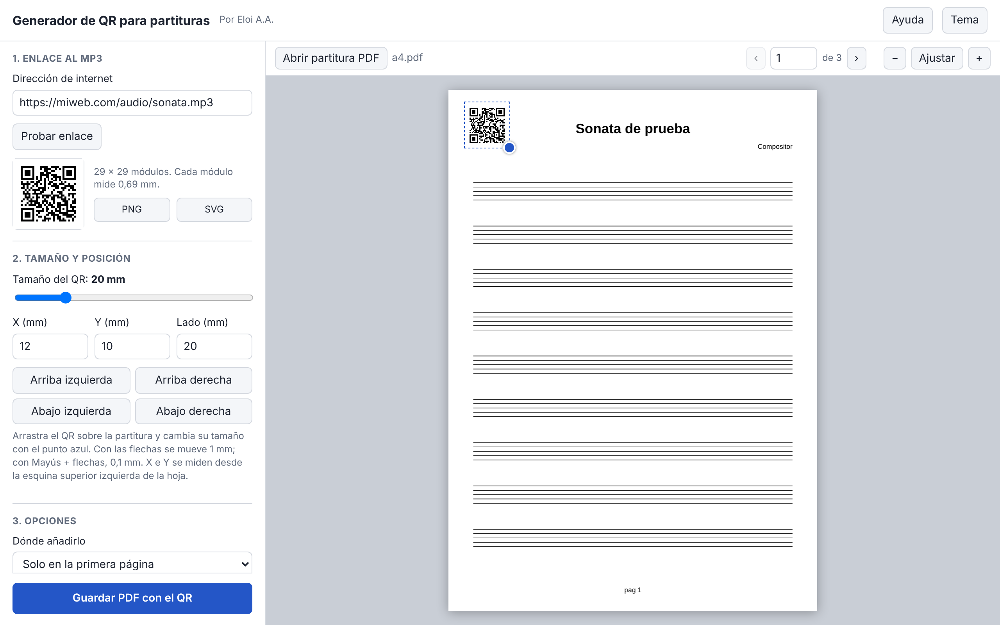

# QR-PDF · Generador de QR para partituras

Añade un código QR con el enlace a un audio (por ejemplo, un MP3 subido a internet) sobre una partitura en PDF. Quien tenga la partitura impresa escanea el código con el móvil y escucha la obra.

**Usarlo en línea:** https://eloiaa-hub.github.io/QR-para-PDFs/

## Características

- **Sin conexión:** es un único archivo HTML (`QR-PDF.html`). Se descarga y se abre con doble clic, sin instalar nada.
- **Privado:** la partitura no sale del ordenador.
- **Vista previa:** el QR se mueve con el ratón o el dedo, se redimensiona y se coloca con precisión en milímetros o con las flechas del teclado.
- **Calidad de imprenta:** el QR se añade como dibujo vectorial; el resto del PDF no se modifica ni pierde calidad.
- **Se guarda como copia** (`nombre_QR.pdf`); el original no cambia.
- **Opciones:** el QR va en la primera página, en la página actual o en todas. Se pueden ajustar la corrección de errores y el margen blanco, el QR se puede pulsar como enlace al ver el PDF en pantalla y también se exporta solo el QR en PNG o SVG.
- **Avisos:** indica si el QR queda demasiado pequeño para imprimirlo o si el enlace es demasiado largo.
- **Aspecto:** tema claro y oscuro, y ayuda integrada.

## Uso rápido

1. Pega el enlace del MP3.
2. Abre o arrastra la partitura en PDF.
3. Coloca el QR (por defecto, arriba a la izquierda del título).
4. Pulsa **Guardar PDF con el QR**.

## Manual

- [Manual en HTML](manual.html)
- [Manual en PDF](manual.pdf)

## Archivos

| Archivo | Contenido |
|---|---|
| `QR-PDF.html` | El programa completo (incluye todas las bibliotecas) |
| `index.html` | Página de presentación para GitHub Pages |
| `manual.html` · `manual.pdf` | Manual de uso |
| `img/` | Capturas usadas en la página y el manual |

## Bibliotecas incluidas

`QR-PDF.html` lleva dentro estas bibliotecas de código abierto para funcionar sin internet:

- [PDF.js](https://github.com/mozilla/pdf.js) 3.11 (Apache-2.0): muestra la partitura.
- [pdf-lib](https://github.com/Hopding/pdf-lib) 1.17 (MIT): añade el QR al PDF.
- [qrcode-generator](https://github.com/kazuhikoarase/qrcode-generator) 2.0 (MIT): genera el código QR.

## Licencia

- **Programa** (`QR-PDF.html` e `index.html`): [EUPL-1.2](LICENSE), la Licencia Pública de la Unión Europea. Puedes usarlo, estudiarlo, modificarlo y redistribuirlo. Si distribuyes una versión modificada, debe seguir publicándose con la EUPL o con una licencia compatible.
- **Manual** (`manual.html`, `manual.pdf` y capturas de `img/`): [CC BY-SA 4.0](LICENSE-manual), Creative Commons Atribución-CompartirIgual 4.0 Internacional. Puedes copiarlo y adaptarlo citando la autoría y compartiendo las obras derivadas con la misma licencia.
- Las bibliotecas incluidas conservan sus propias licencias (Apache-2.0 y MIT).

© 2026 Eloi A.A.
